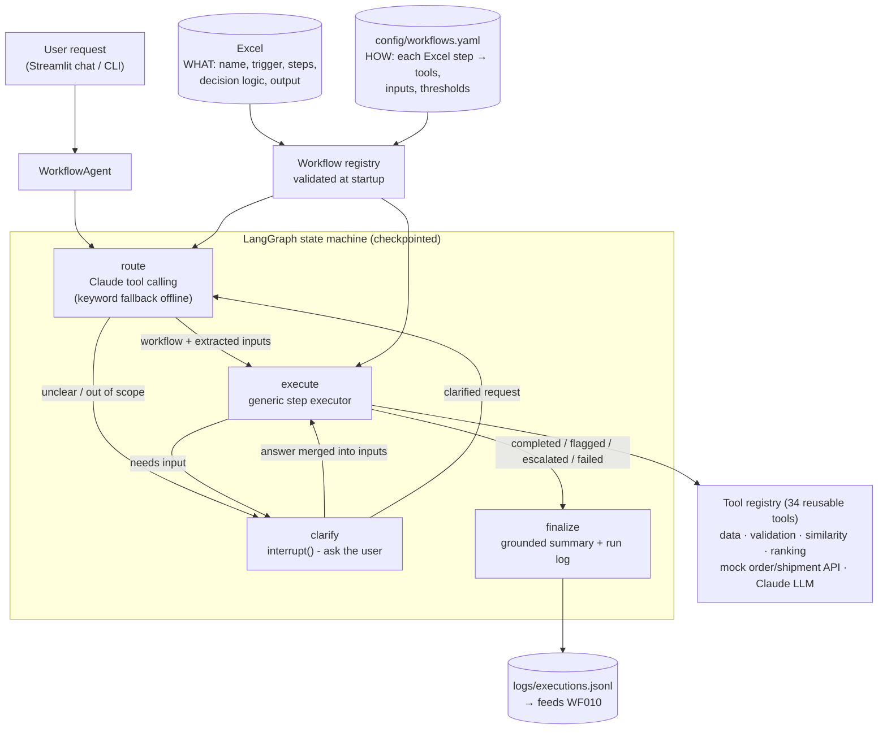

# AI Agent Workflow Automation

A Python AI agent that takes a request in plain English, picks the matching business workflow
from an **Excel file**, runs its steps with tools, handles its conditions and errors, and returns
the result. Every response shows **which workflow was selected, which steps ran, and the final result**.

Built with **LangGraph** (orchestration, human-in-the-loop), **Claude Sonnet 5.5** through the official
Anthropic SDK (tool calling and structured outputs), and **Streamlit** (UI). There is also a CLI and a pytest suite.

```text
User:   Where is order ORD-9999?

Selected Workflow: WF005 - Customer Order Status   (Claude tool calling, confidence: high)
Steps Executed:
  1. ✅ Validate identifier            [validate_identifier]  Valid order id: ORD-9999
  2. ❓ Search order data              [search_orders]        No order found for ORD-9999
Question: I couldn't find any order for ORD-9999. Could you share another order ID or the email address used?

User:   try jane.doe@example.com          <- the paused workflow resumes from its checkpoint

Steps Executed:
  1. ✅ Validate identifier            Valid email: jane.doe@example.com
  2. ✅ Search order data              Found 2 order(s)
  3. ✅ Retrieve order status          ORD-1001: Shipped, ORD-1002: Processing
  4. ✅ Retrieve shipment information  ORD-1001: In transit, ORD-1002: Not shipped yet
  5. ✅ Summarize current status
Result: ORD-1001 is in transit with UPS (tracking 1Z999AA10123456784, ETA 16 Oct) ...
```

---

## Contents
1. [Quick start](#1-quick-start)
2. [Architecture](#2-architecture)
3. [How it works](#3-how-it-works)
4. [The 10 workflows](#4-the-10-workflows)
5. [Conditions and error handling](#5-conditions-and-error-handling)
6. [Adding an 11th workflow](#6-adding-an-11th-workflow)
7. [Example requests and outputs](#7-example-requests-and-outputs)
8. [Testing](#8-testing)
9. [Project structure](#9-project-structure)
10. [Technical decisions](#10-technical-decisions)
11. [Assumptions](#11-assumptions-rules-the-excel-file-leaves-open)
12. [Production readiness and next steps](#12-production-readiness-and-next-steps)

---

## 1. Quick start

**Requirements:** Python 3.11+ (tested on 3.12) and an Anthropic API key. Without a key the app still
runs in *offline mode* (keyword routing, and every non-LLM workflow works).

```bash
git clone https://github.com/theonlyaks/ai_agent_workflow.git && cd ai_agent_workflow
python -m venv .venv
# Windows:  .venv\Scripts\activate        macOS/Linux:  source .venv/bin/activate
pip install -r requirements.txt           # also installs this package in editable mode

cp .env.example .env                      # Windows: copy .env.example .env
# edit .env and set ANTHROPIC_API_KEY=sk-ant-...
```

| Run | Command |
|---|---|
| **Web UI** (chat + steps + results) | `streamlit run app/streamlit_app.py` → http://localhost:8501 |
| CLI, one request (interactive follow-ups) | `workflow-agent ask "Which products need restocking?"` |
| CLI, list workflows from Excel and their tool bindings | `workflow-agent list` |
| Run all Excel test questions and edge cases, save outputs | `workflow-agent test-questions` |
| Unit and end-to-end tests (no API key needed) | `pytest` |
| Regenerate the sample datasets | `python scripts/generate_sample_data.py` |

---

## 2. Architecture



This maps directly onto the architecture in the assignment brief:

| Assignment brief | Implementation |
|---|---|
| User Request | Streamlit chat (`app/streamlit_app.py`) or CLI (`workflow-agent ask`) |
| Agent | `WorkflowAgent` → LangGraph graph (`engine/graph.py`) |
| Identify Workflow | `route` node: Claude tool calling, where **each Excel workflow is a tool** (`engine/router.py`) |
| Workflow Steps | Steps read from the Excel `Steps` column and run in order by the generic `WorkflowExecutor` |
| Tools / APIs | `@tool`-registered functions (`tools/`), referenced by name from YAML |
| Conditions / Decisions | Tool statuses (`flagged`, `needs_input`, `escalate`, `failed`) + graph edges (`clarify` → `interrupt`) |
| Final Result | `finalize` node: result sections + a summary grounded in the data + execution log |

### The key idea: WHAT vs HOW vs TOOLS

| Layer | File | Owned by | Changes when... |
|---|---|---|---|
| **WHAT** a workflow is | `data/AI_Agent_Workflow_Assessment.xlsx` | Business | a process changes |
| **HOW** it runs | `config/workflows.yaml` | Configuration | steps are wired to different tools or thresholds change |
| **Tools** | `src/workflow_agent/tools/*.py` | Engineering | a new capability is needed (rare) |

The engine (router, executor, graph, UI, logging) has **no workflow-specific code**. The 10 workflows
are 10 YAML bindings over **34 shared tools**. For example, `read_table` and `select_columns` are each used by 7 workflows and
`filter_rows` by 6.

---

## 3. How it works

### 3.1 Processing the Excel workflows (`registry/`)
1. `excel_loader.py` reads the `Workflows` sheet, checks the required columns, splits `Steps` on `→`
   and `Inputs`/`Tools_Required` on `;`, and builds a typed `WorkflowDefinition` (Pydantic). The
   `Test_Questions` sheet is loaded too; it drives the UI's sample buttons and the test runner.
2. `workflow_registry.py` joins each Excel row with its YAML binding and **validates everything at
   startup (fail fast)**:
   - the YAML has exactly one entry per Excel step (the trace always mirrors the Excel steps)
   - every tool exists and every argument matches the tool's Python signature
   - every `$reference` points to an input, a parameter, or the output of an *earlier* step
   - every prompt template exists, and every output schema is valid
   - an Excel row **without** a binding is listed in the UI as "not configured" instead of crashing the app

### 3.2 Identifying the workflow (agent reasoning, `engine/router.py`)
- Each executable workflow is turned into a **Claude tool**: `run_wf001` … `run_wf010`. Its description
  is generated from the Excel row (name, trigger, inputs, decision logic, expected output), and its
  parameters come from the YAML input specs. An extra `ask_clarification` tool is added.
- In **one LLM call**, Claude selects the workflow (the tool), **extracts the inputs** it can see in the
  request (the arguments), and states a `routing_reason` and a `confidence`. All of these appear in the UI.
- When the request is ambiguous or out of scope, Claude calls `ask_clarification` instead of guessing.
- **Fallback:** if there is no API key or the API is down, a keyword/fuzzy router scores the same Excel
  text plus optional YAML keywords, and a regex `extract_pattern` per input pulls out IDs, emails and
  percentages. The system keeps working in degraded mode.

### 3.3 Executing the workflow (`engine/executor.py`)
For each Excel step, the executor runs that step's tool call(s) from the YAML:
- resolves `$inputs.x`, `$params.y` and `$<previous_step_output>` references
- invokes the tool, times it, and records metrics, messages and warnings in a **step trace**
- **retries** transient failures (`TransientToolError`, e.g. API 503s) with exponential backoff, per the step's `retry:` policy
- converts tool exceptions into a `failed` step with a clear message, so a bug in one tool never crashes the agent
- stops at the first terminal condition and marks the remaining steps `skipped`

### 3.4 Human in the loop (`engine/graph.py`)
When a step needs information (missing campaign dates, an unknown order, an unspecified task), the
`clarify` node calls LangGraph's `interrupt()`. The graph **pauses with its state checkpointed**. The
user's answer resumes it with `Command(resume=...)`, Claude extracts the new inputs from the
conversation, and the workflow re-runs with the merged inputs. Clarifications are capped
(`MAX_CLARIFICATION_ROUNDS`) so a run can't loop forever.

### 3.5 Final result
`finalize` writes a short answer with Claude, **grounded only in the result data**, and appends the
run (status, steps, durations, token usage) to `logs/executions.jsonl`. The result sections (tables
and records) come straight from the tool outputs, not from the LLM, so the numbers are exact.

---

## 4. The 10 workflows

All rows come from the Excel file. The "Tools" column shows the YAML wiring.

| ID | Workflow | Tools used (per step) | Decision logic, as implemented |
|---|---|---|---|
| WF001 | Inventory Restock Check | `read_table` → `compare_to_threshold` → `filter_rows` → `compute_column` → `select_columns` | `current_stock < minimum_stock` (strict). A threshold the user states ("fewer than 10") overrides per-product minimums. Reorder qty = `threshold × 2 − current_stock` |
| WF002 | Product Price Validation | `read_table`×2 → `join_tables`(outer) → `compute_column` → `compute_column` → `compare_to_threshold` | Flag when `abs((vendor − internal) / internal) > 10%` (or the % the user states). SKUs missing on either side are reported |
| WF003 | Vendor File Processing | `read_table` → `detect_columns` → `rename_columns` → `validate_rows` → `filter_rows` → `export_table` | Rows missing SKU or product name are invalid. Non-numeric cost/qty is a warning. Messy headers are mapped through an alias list |
| WF004 | Product Description Generator | `enrich_from_table` + `validate_fields` → `llm_generate`×4 + `validate_text` | **Never invent attributes.** Missing ones are listed under "missing information". No product given → ask. SEO limits (60/160 chars) are checked |
| WF005 | Customer Order Status | `validate_identifier` → `search_orders` → `get_order_status` → `track_shipments` → `summarize_order_status` | Invalid ID or **no order found → ask for another identifier** (then resume). API calls retried 3× |
| WF006 | Duplicate Product Detection | `read_table` → `normalize_text_columns` → `find_exact_matches` → `find_similar_pairs` → `group_pairs` → `assign_label` | Same normalized SKU → **Definite**. Name ≥ 95 and all attributes equal → **Possible (high)**. Name ≥ 85 and ≥ 75% attributes → **Possible (medium)** |
| WF007 | Marketing Campaign Brief | `validate_fields` → `llm_generate` → `search_table` + `summarize_table` → `llm_generate`×3 + `build_record` | **Goal or dates missing → ask before generating anything** |
| WF008 | SEO Keyword Classification | `read_table` → `drop_duplicate_rows` → `llm_classify`(intent) → `llm_classify`(category) + `join_tables` → `assign_label` → `export_table` | Intent is one of exactly 4 labels (schema-enforced enum). Priority rules use intent and search volume |
| WF009 | Employee Task Assignment | `validate_fields` + `llm_generate` → `skill_match` → `compute_column` → `rank_rows` → `select_best` → `llm_generate` | Skill match ≥ 60%, available capacity ≥ estimated hours, not on leave. Urgent tasks weight capacity higher. **Nobody qualifies → escalate** |
| WF010 | Workflow Performance Report | `load_execution_logs` → `aggregate` → `aggregate` + `join_tables` → `aggregate` → `aggregate` → `assign_label` + `llm_generate` | **Flag failure rate > 10% or avg run time > 10 s.** Reads historical logs **plus this app's own run log** |

Tools that call Claude are used only where language understanding is required (WF004, WF007, WF008,
WF009 requirements, WF010 recommendations). All arithmetic, matching, thresholds, ranking and
validation are deterministic Python, so they are exact, testable and free.

---

## 5. Conditions and error handling

| Situation | Mechanism | Where you see it |
|---|---|---|
| Business exception (price > 10%, failing workflow, SEO title too long) | tool returns `flagged` → run status `completed_with_flags` | ⚠️ step + "Flags" box |
| Missing / invalid required info (no product, no goal/dates, bad order ID, order not found, no task) | tool returns `needs_input` + a question → `interrupt()` → resume | ❓ step + question, then resumes |
| Nobody can do the task | tool returns `escalate` → workflow stops, hand-off message | 🔺 Escalation section |
| Request unclear or out of scope | router calls `ask_clarification` | Question listing what the agent can do |
| Transient API error (503 / timeout) | `TransientToolError` → retry with exponential backoff (`retry:` in YAML) | attempts shown per tool call |
| Bad file / missing column / unsupported format | `ToolError` → `failed` step with a clear message, later steps `skipped` | ❌ step + error |
| Data quality issues (blank stock value, non-numeric cost) | tool `warnings` (row kept or skipped, never silently) | Warnings panel |
| Claude unavailable / no key | router falls back to keywords; LLM steps fail cleanly; optional LLM steps (`continue_on_error`) are skipped | routing method shown |
| Claude refusal / truncated output | `stop_reason` checked → `LLMRefusalError` / `LLMError`. Server-side refusal fallback enabled | error message |
| Unexpected bug in a tool or node | caught by the executor / node wrapper, logged with a stack trace, run marked `failed` | the UI never crashes |
| Invalid configuration | `ConfigError` at startup listing every problem | startup error |

Use `MOCK_API_FAILURE_RATE=0.3` in `.env` to watch the retries happen on WF005.

---

## 6. Adding an 11th workflow

An example is ready in [`examples/wf011_low_margin/`](examples/wf011_low_margin/README.md):

1. **Excel:** add one row (*Low Margin Product Alert*: Load products → calculate profit margin → flag low-margin products → generate margin report).
2. **YAML:** paste [`binding.yaml`](examples/wf011_low_margin/binding.yaml) (about 25 lines that only reuse `read_table`, `compute_column`, `compare_to_threshold`, `filter_rows` and `select_columns`).
3. Click **Reload Excel** in the sidebar and ask *"Which products have a low profit margin?"*

**Zero Python changes.** The router turns it into a new Claude tool automatically, and the startup
validation checks the binding. `python scripts/add_wf011_demo.py` (and `--remove`) does steps 1–2 for
you, and `tests/test_registry_and_extensibility.py` proves it end-to-end. If a new workflow needs a
new capability (e.g. a real ERP API), the only code to write is one `@tool` function.

---

## 7. Example requests and outputs

[`outputs/results/`](outputs/results/README.md) contains a saved run (with Claude) of **all 10 Excel test
questions plus 9 edge cases**, one Markdown file per conversation and `results.json`. Regenerate with
`workflow-agent test-questions`.

| Request (from the Excel `Test_Questions` sheet) | Expected behaviour |
|---|---|
| Which products need restocking? | WF001 → 7 products. SKU-1008 (stock = threshold) is correctly *not* included |
| Find products where vendor price differs by more than 10%. | WF002 → 5 exceptions, 2 unmatched SKUs. SKU-1005 (exactly 10%) is not flagged |
| Process this vendor spreadsheet and show invalid rows. | WF003 → 3 invalid / 9 valid rows, cleaned CSV exported (attach your own file with 📎) |
| Generate SEO content for this product. | WF004 → asks *which* product first; never invents attributes |
| Where is order ORD-1001? | WF005 → Shipped, in transit with UPS + tracking (ORD-9999 → asks for another identifier) |
| Find likely duplicate products in the catalog. | WF006 → 5 groups: 1 definite, 3 high, 1 medium. The colour variant is excluded |
| Create a campaign brief for the new collection. | WF007 → asks for goal + dates, then builds the brief for the 6 "new collection" products |
| Classify these keywords and map them to pages. | WF008 → 22 unique keywords (2 duplicates removed) with intent, category, priority, target page |
| Assign this urgent task to the best available developer. | WF009 → asks which task (lists the backlog), then ranks; T-204 (Swift) **escalates** |
| Which workflows are failing most often? | WF010 → WF005 (~19%) and WF003 (~16%) flagged for failures, WF008 for being slow, plus recommendations |

Sample data (`data/samples/`, generated by `scripts/generate_sample_data.py`) simulates the business
systems. Every decision rule is exercised, including edge cases (exactly-at-threshold values, blank
values, unknown SKUs, duplicate keywords, an employee on leave, messy vendor headers).

---

## 8. Testing

```bash
pytest            # 56 tests, ~8 s, no API key or network needed
```

| Test file | Covers |
|---|---|
| `test_excel_loader.py` | Excel parsing, step splitting, missing columns/file errors |
| `test_registry_and_extensibility.py` | Startup validation (bad tool/arg/reference/step count), unconfigured rows, **the 11th workflow added with zero code** |
| `test_tools.py` | Each reusable tool's logic (thresholds, joins, rules, validation, similarity, ranking, LLM label enforcement) |
| `test_workflows.py` | **All 10 workflows end-to-end**, including every decision rule and condition (ask, escalate, retry, flag, fail) |
| `test_router_and_graph.py` | LLM tool-call routing, clarification, LLM-outage fallback, bounded clarification loop, execution log |

LLM steps are tested with `FakeLLM` (deterministic, schema-valid answers). Real Claude behaviour is
checked by `workflow-agent test-questions`, with saved outputs in `outputs/results/`.

---

## 9. Project structure

```text
├── app/streamlit_app.py            # Chat UI: workflow, steps, results; Workflows and Run log tabs
├── config/workflows.yaml           # HOW: Excel step → tool bindings, inputs, thresholds
├── data/
│   ├── AI_Agent_Workflow_Assessment.xlsx   # WHAT: the 10 workflows + test questions (source of truth)
│   └── samples/                    # simulated business data (CSV / XLSX / JSON)
├── prompts/*.md                    # Claude prompt templates (editable without code)
├── examples/
│   ├── test_scenarios.yaml         # follow-up answers + edge cases for the test runner
│   └── wf011_low_margin/           # the 11th-workflow example
├── outputs/results/                # saved results of the test-question run
├── scripts/                        # sample data generator, WF011 demo helper
├── src/workflow_agent/
│   ├── core/        config (pydantic-settings), structured logging, exceptions, domain models
│   ├── registry/    Excel loader + workflow registry (validation)
│   ├── engine/      LangGraph graph, router, executor, input extractor, summarizer, run log, rendering
│   ├── llm/         Claude client (Anthropic SDK), prompt library, schema helper, FakeLLM
│   ├── tools/       34 tools: data, validation, similarity, ranking, mock APIs, reporting, LLM
│   └── cli.py       `workflow-agent` command
└── tests/                          # pytest suite
```

---

## 10. Technical decisions

| Decision | Why | Trade-off |
|---|---|---|
| **Excel = WHAT, YAML = HOW, tools = code** | The Excel stays the business source of truth, unchanged. Execution wiring is explicit, reviewable and validated. A new workflow is config, not code | Two files to edit for a new workflow (instead of one), but each has one clear purpose |
| **Deterministic tools + LLM only where needed** | Thresholds, prices, rates and rankings must be exact and repeatable. The LLM handles language: routing, input extraction, content generation, classification | Less "free-form" than a ReAct agent that improvises steps, but every Excel step runs exactly once, in order, auditable |
| **Workflows as Claude tools for routing** | Selection *and* input extraction in one call, with a reason and confidence. New workflows become routable automatically. Native clarification via a tool | One extra LLM call per request (~1–2 s, a few hundred tokens) |
| **LangGraph** | Explicit state machine (route → execute → clarify → finalize), checkpointing, and `interrupt()` for real human-in-the-loop pauses and resumes | A framework dependency. The graph itself is about 100 lines |
| **Official Anthropic SDK** (not a LangChain chat-model wrapper) | Direct access to structured outputs (JSON schema), tool calling, refusal fallback, typed errors and usage. A thin `LLMClient` protocol keeps the provider swappable | A little adapter code to write |
| **Structured outputs everywhere the LLM returns data** | Classification labels are a schema `enum`, so the model can't return an invalid intent. Content fields are typed | Schema must be declared (compact YAML syntax keeps it short) |
| **Claude Sonnet 5.5 at low effort** for routing/extraction | Fast and cheap for short decisions, and plenty for this task. The model is configurable in `.env` | — |
| **Fail-fast config validation** | Typos in YAML surface at startup with a precise message, not mid-demo | Stricter config |
| **Offline mode + keyword fallback** | The app is usable and testable without a key, and degrades gracefully during API outages | Lower routing quality offline |
| **JSON-only graph state** | Any LangGraph checkpointer (memory → SQLite/Postgres) can persist runs, enabling multi-instance deployment | DataFrames are converted to records at step boundaries |

---

## 11. Assumptions (rules the Excel file leaves open)

All of these are parameters in `config/workflows.yaml`, so they can be changed without code.

| WF | Assumption |
|---|---|
| WF001 | Suggested reorder quantity = `minimum threshold × 2 − current stock` (`target_stock_multiplier: 2`). Products with no stock value are reported, not guessed |
| WF002 | % difference is relative to the **internal** price; the absolute value is compared with the threshold (higher *or* lower). "More than 10%" is strict (exactly 10% is not flagged) |
| WF003 | Required fields are `sku` and `product_name`. Bad numbers in cost/quantity are warnings (the row is kept, the value cleared) |
| WF004 | Product name is required to proceed. Other attributes are optional; when one is missing it is listed, never invented. When a SKU or known name is given, attributes are filled from the catalog |
| WF005 | Identifier = `ORD-####` or an email. An email can match several orders, and all are shown |
| WF006 | Confidence levels and similarity thresholds as in section 4. Fuzzy comparison is blocked by category for scalability |
| WF007 | Campaign goal, start date and end date are required. Products are matched against the catalog (e.g. "new collection" → items tagged *new collection*) |
| WF008 | High priority = commercial/transactional intent with ≥ 1,000 monthly searches. Medium = commercial/transactional or ≥ 400. Informational keywords target guide pages, the others target category pages |
| WF009 | Eligible = skill match ≥ 60%, free hours ≥ estimate, not on leave. Score = 0.6·skill + 0.4·capacity (urgent: 0.5/0.5). "Developer" filters the role |
| WF010 | "Defined threshold" for average run time = **10 s**. Failure rate > 10%. Slow step > 3 s. Run status is failed if any step failed |

---

## 12. Production readiness and next steps

**Already in place:** typed config via environment variables (`.env`); structured JSON logs with a
per-run correlation id (`logs/app.log`, rotated); a per-run execution log with timings and token usage;
retries with backoff; typed exception hierarchy; startup validation; graceful degradation; 56 automated
tests; pinned dependencies; secrets kept out of git.

**Next steps for a real deployment:**
- Swap `InMemorySaver` for the SQLite/Postgres LangGraph checkpointer (state is already JSON-serializable) and serve the agent behind an API (FastAPI)
- Replace `MockCommerceAPI` / CSV readers with real connectors (same tool signatures)
- With hundreds of workflows, use Claude's tool search, or pre-filter candidates with embeddings before routing
- An eval set for routing accuracy and content quality (LLM-as-judge), run in CI
- Auth, rate limiting and PII redaction in logs; OpenTelemetry traces
